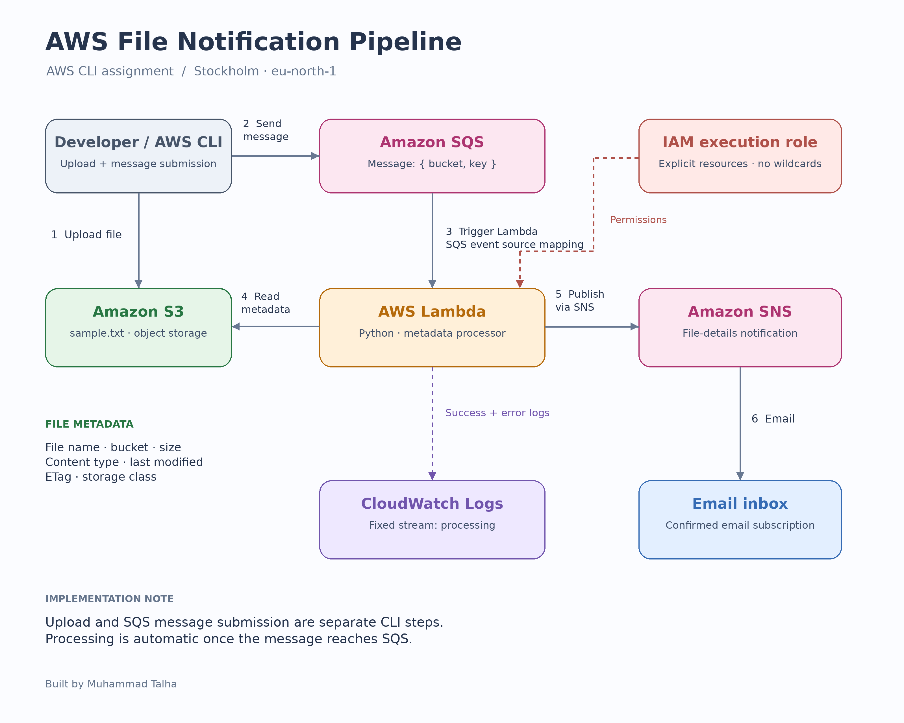
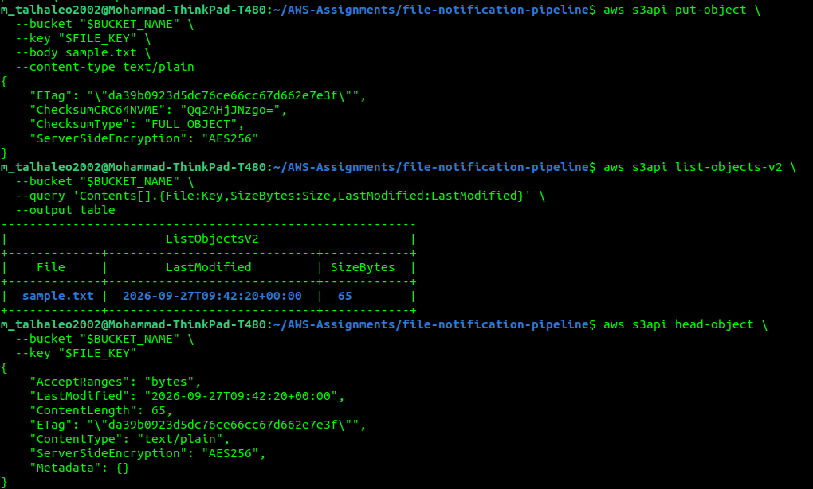
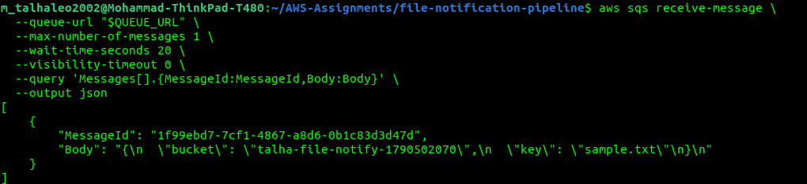
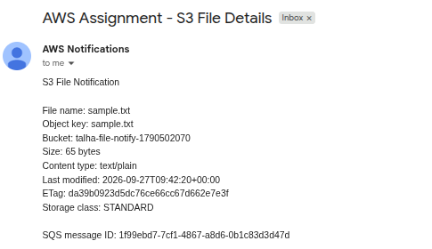
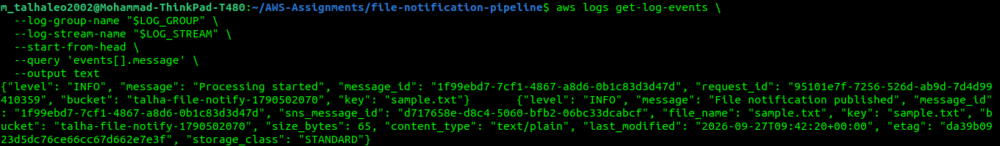

# AWS CLI File Notification Pipeline

A serverless assignment built using AWS CLI commands in the Stockholm
region (`eu-north-1`).

A sample file is uploaded to Amazon S3. Its bucket name and object key
are manually sent to Amazon SQS. An event source mapping invokes
AWS Lambda, which reads the object's metadata and publishes an email
notification through Amazon SNS.

## Architecture



The S3 upload and SQS message submission are separate CLI steps.
Automatic S3-to-SQS event notifications are not configured in this version.

## AWS services

- Amazon S3: stores the sample file.
- Amazon SQS: queues the file reference.
- AWS Lambda: validates the message and retrieves metadata.
- Amazon SNS: sends notifications to a confirmed email subscription.
- AWS IAM: controls deployment and runtime permissions.
- Amazon CloudWatch Logs: stores application processing logs.

## Message format

```json
{
  "bucket": "<BUCKET_NAME>",
  "key": "sample.txt"
}
```

## Email contents

- File name and object key
- Bucket name
- Size in bytes
- Content type
- Last modified timestamp
- ETag
- Storage class

## Lambda configuration

- Runtime: Python 3.13
- Handler: lambda_function.lambda_handler
- Memory: 128 MB
- Timeout: 30 seconds
- SQS visibility timeout: 180 seconds
- Batch size: 1
- Partial batch responses: ReportBatchItemFailures

Required environment variables:

- TOPIC_ARN
- LOG_GROUP
- LOG_STREAM
- ALLOWED_BUCKET
- ALLOWED_KEY

## Permissions and logging

The Lambda execution role uses explicit resource ARNs without wildcards.
It can read the selected S3 object, consume the selected SQS queue,
publish to the selected SNS topic, and write to one pre-created log stream.

Application logs are written explicitly using the CloudWatch Logs API.
Default Lambda START, END, and REPORT logs are not provided by this setup.

An IAM user was used for application deployment and testing.
The root bootstrap profile was used for initial permission provisioning,
execution-role and log-resource creation, and event source mapping setup.

The files in policies/ are sanitized templates. Replace placeholders
with your own values before using them.

## Error handling and limitations

The function validates the message and restricts processing to the
configured bucket and object key. Failed message IDs are returned for retry.

SQS/Lambda processing is at least once; duplicate notifications are possible.
This version does not implement deduplication or a dead-letter queue.
Failed messages can be retried until the queue's retention period expires.

## Execution evidence

### S3 upload and metadata


### SQS message


### Email received


### CloudWatch application logs


## Learnings

This assignment helped me understand IAM user permissions versus Lambda
execution roles, SQS visibility timeouts, partial batch failure responses,
and how to verify processing using application logs and email delivery.

## Cleanup

Delete the event source mapping, Lambda function, SNS topic, SQS queue,
sample S3 object and bucket, CloudWatch log group, and assignment IAM
resources after collecting evidence.

## Author

Muhammad Talha

## Documentation

- [CLI command reference](commands.md)
- [Cleanup instructions](cleanup.md)
